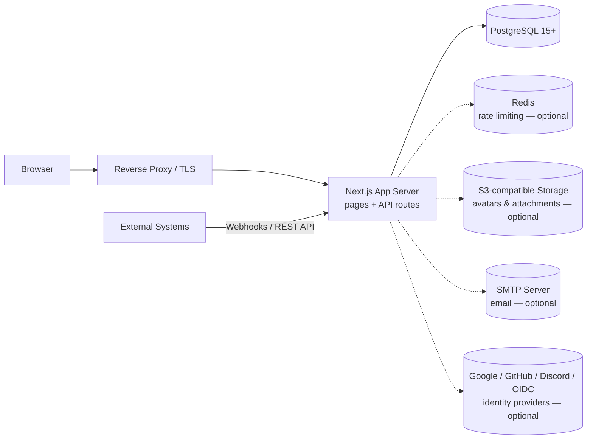

# ProjectBoard — System Architecture

## 1. High-Level Design

ProjectBoard is a **full-stack web application** built on a single deployable unit: a Next.js application server backed by PostgreSQL, with optional external services (SMTP, S3-compatible storage, Redis) that are strictly optional.



**Deployment topology (Docker Compose):** a run-once `migrate` container applies database migrations, then the `web` container starts, backed by a `postgres` service with a health check. All services sit on a private bridge network; only the web port is published.

## 2. Technology Stack

| Layer | Choice | Rationale |
|---|---|---|
| Frontend & server | **Next.js** (pages router), React, TypeScript | One framework for UI and API; server-side rendering for fast first paint and SEO-friendly public boards. |
| API layer | **tRPC** (end-to-end typesafe RPC) plus an auto-generated **OpenAPI REST layer** (`/api/v1`) for external consumers | Type safety across client/server; public API for integrations without tRPC coupling. |
| Styling | **Tailwind CSS** + shadcn-style component primitives | Consistent, minimal design system; fast iteration. |
| Animation / DnD | framer-motion, **@dnd-kit** | Accessible, performant drag-and-drop with keyboard support. |
| Rich text | Lightweight rich-text editor component for card descriptions and comments | Formatted task descriptions without heavyweight CMS dependencies. |
| Database / ORM | **PostgreSQL** + **Drizzle ORM** with timestamped SQL migrations (Drizzle Kit) | Type-safe schema-as-code; migrations are plain SQL reviewed in version control. |
| Auth | **Better Auth** (email/password, social, OIDC, API keys, sessions) | Single integrated session/auth layer with server-side session records. |
| Email | **React Email** templates over any SMTP server | Provider-independent; works with internal relays or services like Resend. |
| i18n | Externalised message catalogues (e.g. Lingui) | English shipped; more languages added without code changes. |
| Monorepo tooling | pnpm workspaces + Turborepo; shared ESLint/Prettier/TS configs across `apps/*` and `packages/*` | Clean separation of web app, API package, DB package, auth, email. |
| Testing | Vitest (API integration tests), Playwright (end-to-end) | |

### Suggested monorepo layout

```
repo/
├── apps/
│   └── web/            # Next.js application (pages, components, Dockerfile)
├── packages/
│   ├── api/            # tRPC routers (board, card, list, label, member,
│   │                   #   workspace, permission, attachment, checklist,
│   │                   #   webhook, import, integration, feedback, health)
│   ├── db/             # Drizzle schema, migrations/, repository layer, Redis client
│   ├── auth/           # Better Auth configuration
│   ├── email/          # React Email templates
│   └── shared/         # shared types & utilities
└── docker-compose.yml
```

## 3. Data Model (core entities)

Relational schema (~30 tables). Key entities and relationships:

```
user ──< session, account, verification, apikey (auth tables)
user >── workspace_members ──< workspace ──< workspace_invite_links
workspace ──< boards ──< list ──< cards ──< card_comments
                                        ├──< card_activity      (typed, immutable)
                                        ├──< card_attachment
                                        ├──< cards_to_labels >── label
                                        ├──< cards_to_workspace_members
                                        ├──< card_checklist ──< card_checklist_item
                                        └── card numbers (per-board sequence)
workspace ──< workspace_roles ──< workspace_role_permissions
workspace ──< workspace_member_permissions
workspace ──< workspace_webhooks ──< webhook_events
workspace ──< imports (e.g. Trello import jobs, with status)
user >──────< notifications
user_board_favorites (user × board)
```

Design notes:

- **Activity is append-only** (`card_activity` with a typed event enum) — powers both the card history UI and audit requirements.
- **Soft deletion** on boards/cards via `isArchived` flags.
- **Custom roles** are a role → permission mapping, overridable per member.
- **Slugs** give every workspace/board a human-readable URL (`/<workspaceSlug>/<boardSlug>`), checked for uniqueness at creation.

## 4. API Surface

| Surface | Location | Purpose |
|---|---|---|
| Internal RPC | `/api/trpc/*` (tRPC) | All UI operations — type-safe, session-authenticated |
| Public REST | `/api/v1` (OpenAPI spec at `/api/v1/openapi.json`) | External integrations; Bearer API keys (`pbk_…` style) |
| Auth | `/api/auth/*` | Better Auth handlers (login, OAuth/OIDC callbacks, password reset) |
| Uploads | `/api/upload/{avatar,attachment}`, `/api/download/attachment` | Direct-to-server then S3 (or local fallback) |
| Webhooks | outbound, workspace-scoped | Event delivery with per-endpoint event log & retry |
| Admin | server-only admin API key | Instance statistics and maintenance endpoints |
| AI assistant (Phase 2) | MCP-compatible server (npx-distributable or in-app endpoint) | Natural-language control over the same API surface |

## 5. Security Architecture

- **Authorisation is enforced in the API layer** — every tRPC procedure and REST route re-checks board/workspace membership and visibility; the UI never trusts client state.
- Parameterised queries exclusively via the ORM; no raw string interpolation.
- Sessions: httpOnly, SameSite cookies; server-side session table allows revocation.
- Rate limiting on login/sign-up (Redis when available, in-memory fallback).
- Upload restrictions: file-type allow-list, avatar size cap (2 MB), configurable request body limit.
- Secrets via environment variables only; no secrets in the client bundle (`NEXT_PUBLIC_*` naming convention strictly reviewed).
- Deployment assumes TLS termination at a reverse proxy (nginx/Traefik/cloud LB).

## 6. Build & Release

- **Web image**: multi-stage build — dependency pruning (`turbo prune`), `pnpm install`, Next.js *standalone* output, final stage on a **distroless Node base** (minimal attack surface), port 3000. A small bootstrap script injects runtime environment variables so one image serves any environment.
- **Migrate image**: separate lightweight run-once image executing `drizzle-kit migrate` against the configured `POSTGRES_URL`.
- CI runs lint, type-check, unit/integration tests (Vitest) and end-to-end tests (Playwright) before image publication.
